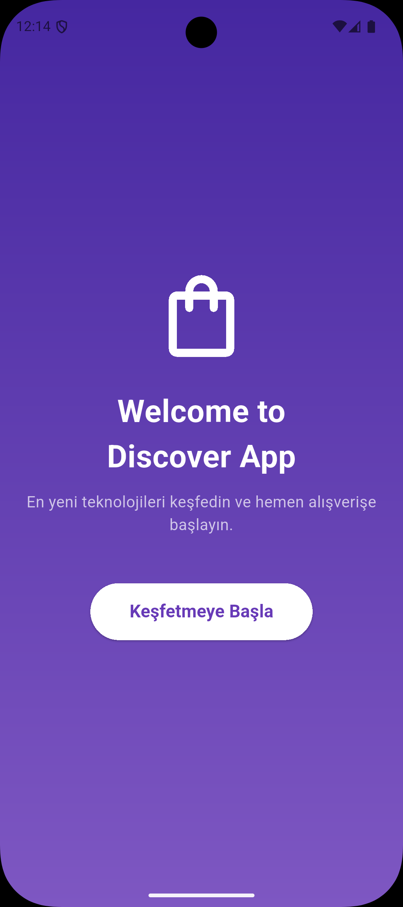
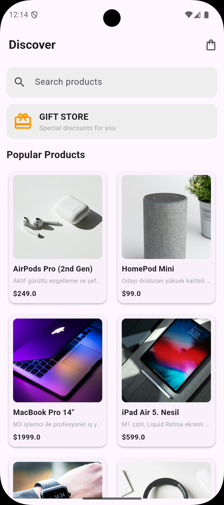
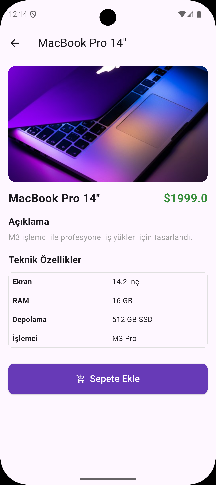
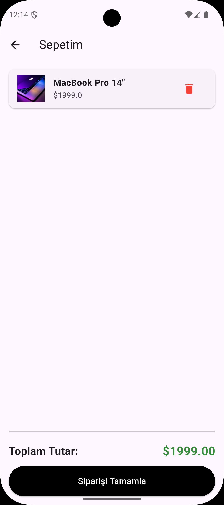

# Discover App - Mini Katalog Uygulaması

**Discover App**, kullanıcıların en yeni teknolojik ürünleri ve aksesuarları keşfedebileceği, detaylı özelliklerini inceleyebileceği ve sepetlerini yönetebileceği modern bir Flutter e-ticaret mobil uygulamasıdır.

## Ekran Görüntüleri

| Giriş Ekranı | Katalog (Discover) | Ürün Detay | Sepetim |
| :---: | :---: | :---: | :---: |
|  |  |  |  |

##     Özellikler

* **Karşılama Ekranı (Welcome Screen):** Şık gradyan arka planı ve modern açılış tasarımı.

* **Dinamik Ürün Kataloğu:** GridView yapısı ile yan yana kutular şeklinde listelenen 15 farklı teknolojik ürün.

* **Arama ve Kampanya Alanı:** Arama çubuğu ve özel teklif/kampanya görsel banner alanı.

* **Detaylı Ürün Sayfası:** Ürün açıklamaları ve teknik özellikleri içeren düzenli tablo yapısı.

* **Dinamik Sepet Yönetimi:**

  * Anlık olarak ürün ekleme ve sepetten ürün çıkarma.

  * Toplam tutarın anlık ve dinamik olarak hesaplanması.

  * Uygulama başlığında (AppBar) sepet adedini gösteren rozet (badge).

##   Kullanılan Teknolojiler ve Sürümler

* **Flutter:** `3.x.x` (veya kullandığınız sürüm, örneğin `3.19.0`)

* **Dart:** `3.x.x`

* **Tasarım:** Material Design 3

##  Çalıştırma Adımları

Projeyi kendi yerel makinenizde çalıştırmak için aşağıdaki adımları sırasıyla uygulayabilirsiniz:

### 1. Gereksinimler

* Bilgisayarınızda **Flutter SDK** ve **Dart** kurulu olmalıdır.

* **Android Studio** (Emülatör için) veya **VS Code** kurulu olmalıdır.

### 2. Projeyi Klonsuz/Yerel Açma veya Klonlama

Eğer projeyi GitHub'dan indiriyorsanız terminalde şu komutu çalıştırın:

```
git clone https://github.com/kkaantt/mini_katalog_app.git
cd mini_katalog_app

```

### 3. Bağımlılıkları Yükleme

Proje dizinindeyken gerekli paketleri çekmek için terminale yazın:

```
flutter pub get

```

### 4. Uygulamayı Çalıştırma

Bağlı bir cihazda veya hazır bir emülatörde uygulamayı başlatmak için:

```
flutter run

```

##    Geliştirici

* **Proje Sahibi:** \[Kaan Turan\]

* **GitHub:** https://github.com/kkaantt